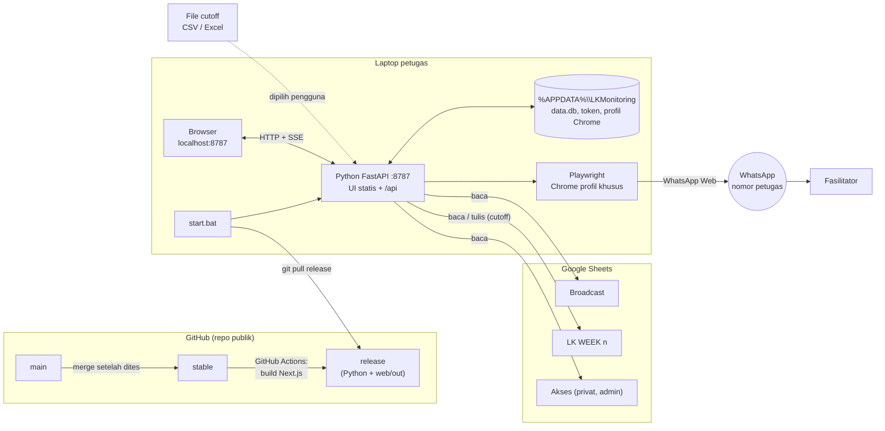
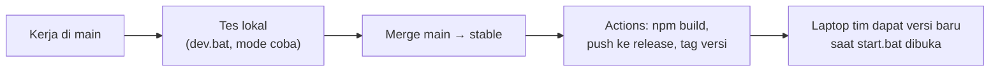
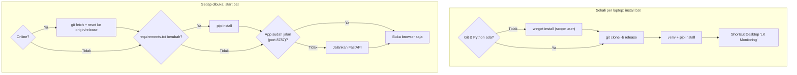
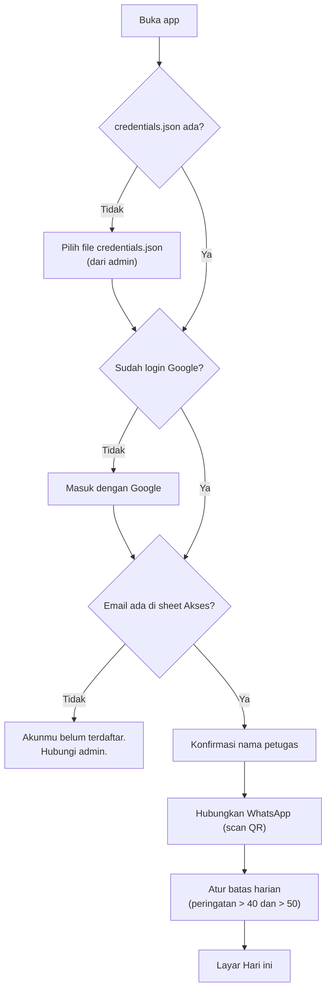
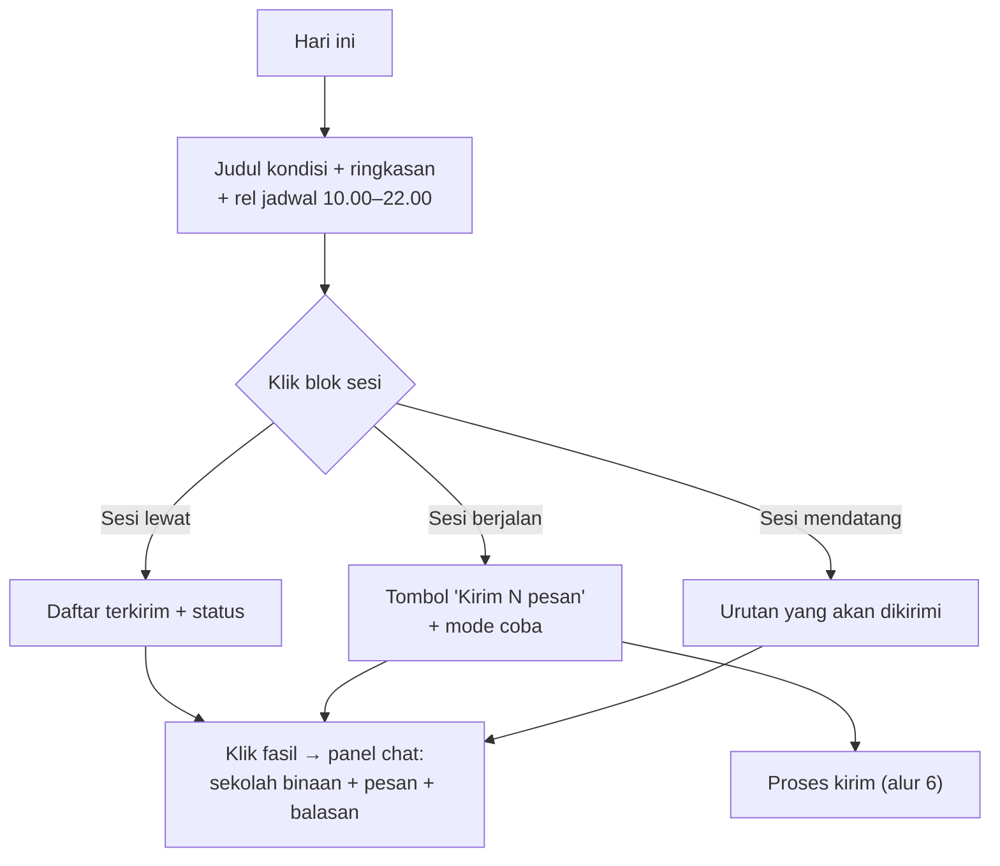
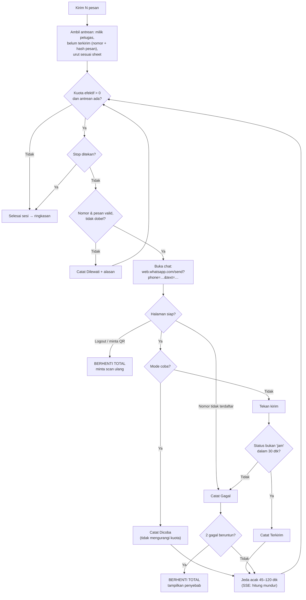
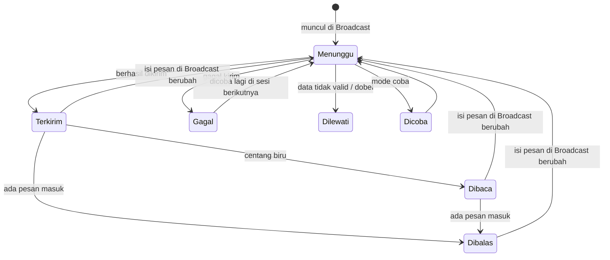
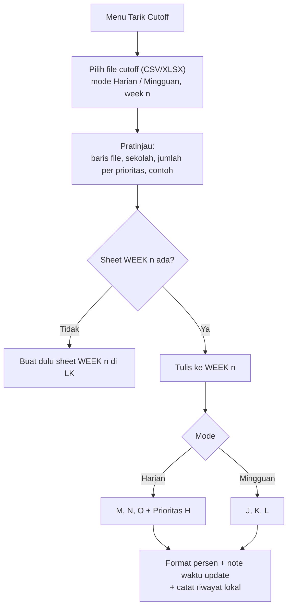
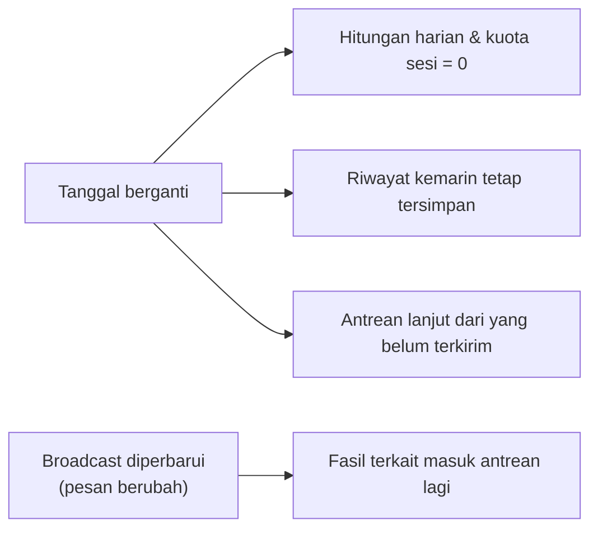

# Alur Sistem – LK Monitoring

Pelengkap [PRD.md](PRD.md) dan [TASKS.md](TASKS.md). Diagram memakai Mermaid (tampil di GitHub, atau di VS Code dengan ekstensi *Markdown Preview Mermaid Support*).

---

## 1. Arsitektur

- Tidak ada server pusat; setiap laptop menjalankan app sendiri.
- Tim hanya butuh **Git + Python + Chrome**. Node.js hanya dipakai developer dan GitHub Actions.
- Data pengguna di luar folder repo, sehingga update tidak menyentuhnya.

---

## 2. Siklus Rilis

---

## 3. Instalasi & Membuka App

---

## 4. Setup di Dalam App (sekali, bisa diulang dari Pengaturan)

---

## 5. Layar Hari ini

Judul kondisi:

| Kondisi | Judul | Tombol kirim |
|---|---|---|
| Di dalam sesi, ada kuota | Sesi 2 sedang berjalan, sampai 15.59 | Kirim N pesan |
| Kuota sesi habis | Kuota sesi 2 habis, sesi 3 mulai 16.00 | Nonaktif |
| Batas harian tercapai / lewat 22.00 | Pengiriman hari ini selesai | Nonaktif |
| Sebelum 10.00 | Sesi 1 mulai 10.00 | Nonaktif |
| Sabtu/Minggu (tidak diizinkan) | Akhir pekan, kirim dimatikan | Nonaktif |

---

## 6. Proses Kirim Satu Sesi

---

## 7. Status Fasilitator

Pembaruan Dibaca/Dibalas: saat app dibuka dan tiap 15 menit (untuk kiriman 7 hari terakhir), hanya saat tidak sedang mengirim.

---

## 8. Tarik Cutoff (pengguna dengan fitur `cutoff`)

Pemetaan prioritas: P1 belum submit · P2 sudah submit, progres < 50% · P3 sudah submit, ≥ 50%, belum reviu · Selesai.

---

## 9. Pergantian Hari

